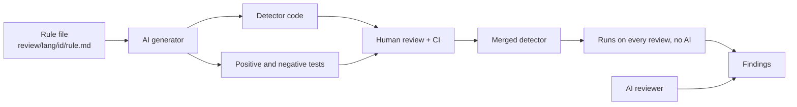

# AI-Generated Deterministic Checks

**Status:** Proposal
**Origin:** Concept from the Mrlens MR review tool, where Copilot is the only component that finds issues.

## Table of Contents

- [Problem](#problem)
- [Concept](#concept)
- [Rule Files](#rule-files)
- [Script Engine](#script-engine)
- [Generation Workflow](#generation-workflow)
- [Runtime Integration](#runtime-integration)
- [Which Rules Suit Deterministic Checks](#which-rules-suit-deterministic-checks)
- [Quality Controls](#quality-controls)
- [Risks](#risks)
- [Rollout](#rollout)

## Problem

An AI-only reviewer finds every issue with a model call. That has costs:

- **Cost and latency**: mechanical patterns (an empty `catch`, `yaml.load` without a safe loader)
  are paid for on every review.
- **Non-determinism**: the same diff can produce different findings on different runs.
- **Missed repeats**: the model may overlook a known pattern when a large diff competes for attention.
- **No proof of coverage**: a prompt rule cannot be unit tested.

An earlier Mrlens version used hand-written Java rules, and it was dropped because the rules were
narrow, Java-only and tied to CI artifacts. The cost was writing and maintaining them by hand.
AI-generated detectors remove most of that cost.

## Concept

Use the AI **once per rule version** (at release time, or on first use after a rule changes) to write deterministic code. Use that code **on every
review, at run time**, with no model call.



The AI reviewer stays in place for judgement-heavy issues. Detectors take the mechanical ones.

The generated detector is a **Groovy script** run through the Java scripting API (JSR-223), not
compiled Java. Rules can be added or changed without rebuilding the JAR. See
[Script Engine](#script-engine).

## Rule Files

Each rule has its own folder, `review/<language>/<rule-id>/`, and `rule.md` in it is the single source of
truth for both the generated detector and its tests.

| Folder | Applies to |
|---|---|
| `review/java` | `*.java` |
| `review/typescript` | `*.ts`, `*.tsx`, `*.js`, `*.jsx` |
| `review/python` | `*.py` |
| `review/sql` | `*.sql` |
| `review/config` | `*.yaml`, `*.yml`, `*.properties`, `*.json` |
| `review/common` | language-independent rules applied to any source file |

A rule file has these sections, in this order. `review/README.md` has the template.

1. **Metadata**: id, language, category, severity, confidence, detection type, source.
2. **Intent**: the defect in one or two sentences.
3. **Detect**: precise, testable conditions.
4. **Do not flag**: explicit exclusions that keep false positives down.
5. **Examples**: code that must be flagged and code that must not.
6. **Implementation notes**: the preferred mechanism (AST, regex, existing linter rule) and anchoring.
7. **Required tests**: the cases the generator must produce (deterministic and hybrid rules).
8. **AI prompt**, **Why AI / Why hybrid** and **Evaluation cases**: for `hybrid` and `ai` rules, the
   exact question and evidence the tool passes to the model, and snippets with expected verdicts
   used to check the prompt.

Rules should be written so that a generator needs no further interpretation.

Executable rules (`ast`, `regex`, `linter`, `hybrid`) have two companion files next to the rule:

```
review/java/empty-catch-block/rule.md       rule (source of truth)
review/java/empty-catch-block/rule.groovy   generated detector
review/java/empty-catch-block/tests.md      cases: source snippets, `// FLAG` marks expected findings
```

An `ai` rule's folder holds only `rule.md`. The rule id is the folder name, so the finding id stays
`<folder>/<rule-id>`.

`ai` rules have no script. The detection type in the rule file is now a statement about the
*mechanism* the script uses (parse the tree, match text, wrap a linter) and about whether the AI
confirms. It is not a different runtime: every executable rule runs on the Groovy engine.

## Script Engine

JDK 25 has no built-in script engine (Nashorn was removed in JDK 15), so the tool bundles
`groovy-jsr223` and runs every `ast`, `regex`, `linter` and `hybrid` rule through
`javax.script.ScriptEngine`.

### Why Groovy

- Scripts call the Java code-model objects directly, with no interop layer.
- Compact closures and a Java-like syntax, which generators write reliably.
- Statically compilable (`@CompileStatic`) so generated scripts get compile-time errors in CI,
  not at review time.

### Script contract

The engine parses the file and passes the tree to the script. A script receives these bindings and returns a list of results:

```groovy
// review/java/empty-catch-block/rule.groovy
def results = []
ast.findAll(CatchClause).each { c ->
    if (c.body.isEmpty() && !c.hasComment() && !c.catchesTypes('InterruptedException')) {
        results << finding(c.line, "Catch block swallows ${c.exceptionType}")
    }
}
return results
```

| Binding | Purpose |
|---|---|
| `ast` | Parsed tree of the file, read-only. Language-native: JavaParser `CompilationUnit` for `.java`, tree-sitter node for Python and TypeScript, parsed document for YAML, JSON and SQL. `common` rules get a normalized view (comments, string literals, calls, catch blocks, log calls) built the same way for every language |
| `model` | Read-only `CodeModel` facade for the project: resolved symbols, other files, config (below) |
| `file` | Read-only file info: `path`, `language`. Used for path rules such as test sources |
| `diff` | `ChangedLineMap` for the file |
| `finding(line, message[, confidence])` | Returns a finding. Used by `ast`, `regex` and `linter` rules. The optional confidence lowers it below the rule's own, e.g. `'LOW'` when a type could not be resolved |
| `candidate(line, evidence...)` | Returns a candidate. Used by `hybrid` rules, which pass it to the AI with the rule's `AI prompt` |

The engine drops any result whose line is not a changed line, applies the severity cap from the rule
file, and stamps the source `rule:<folder>/<id>`.

### Code model facade

Scripts do not parse files or touch the filesystem. The core engine parses each file once, caches the
tree, and hands it to every matching script as `ast`. For anything outside the file, scripts query a
`CodeModel` built once per review. This is what lets rules that need context from other files run
without the AI.

| Facade | Answers |
|---|---|
| Symbol-resolved syntax tree | types, annotations, call targets, statement order (JavaParser with symbol solver; tree-sitter for Python and TypeScript). `model.typeOf(expr)` returns the qualified type name, or `null` when it cannot be resolved |
| Call graph and type hierarchy | callers, "is this a listener or `@ExceptionHandler` boundary" |
| Framework model | JPA entities (fetch type, `@Version`), `@Transactional` scope, security config, Kafka and Rabbit container settings, parsed from `application.yml` and `@Configuration` classes |
| Lock and flow facts | lock acquisition order, try/finally, resource closing |
| Diff mapping | changed lines, so findings anchor correctly |

When a fact is unavailable (classpath not resolved, config not found) the facade returns an explicit
`unknown`. A rule must treat unknown as "do not report" or emit a `LOW` confidence candidate.

### Sandbox

The scripts are AI-generated and run on a developer's machine against untrusted diffs. JSR-223 has no
sandbox of its own, so the engine adds one:

- Compile with `SecureASTCustomizer`: allowlist of imports and receiver classes (the facade, collections,
  `String`, `regex`, `Math`). No `System`, `Runtime`, `ProcessBuilder`, `File*`, `Files`, `Class`,
  reflection, `java.net`, `evaluate` or `GroovyShell`.
- Make the `ast` read-only: expose query and traversal methods only, and deny node mutation
  (`replace`, `remove`, `setParentNode` and similar), so one script cannot alter the tree another reads.
- Deny metaprogramming (`metaClass`, `invokeMethod` overrides, `@Grab`).
- Hard per-script timeout and a memory/step budget. A script that exceeds it is aborted and reported
  as a rule failure. It never blocks the review.
- Treat every generated script as untrusted, because it is now accepted without human review. The
  sandbox and the acceptance gate are the only controls on user-store scripts, so a sandbox escape
  is a code-execution bug on the developer's machine.
- Never load a script from the reviewed repository. Scripts come only from the tool's own `review/`
  directory, so reviewed code cannot supply a detector.

### Testing

`tests.md` in the rule's folder holds Markdown test cases: fenced source snippets, with `// FLAG` on each line that must produce a finding (see `review/README.md`). A test runner loads the
script, runs each case through the engine, and asserts the result. It is the "Required tests"
section of the rule file in executable form, and it is what the mutation and determinism checks
in [Quality Controls](#quality-controls) run on.

## Generation Workflow

The rule file is the only thing a maintainer edits. The tool regenerates a script **when it finds the
script stale**, using the same AI driver it uses for review. The AI is already required for `ai` and
`hybrid` rules, so generation adds no new dependency.

### When generation runs

At the start of a review, the rule loader checks every executable rule:

1. Read the rule file and compute its `rule-hash` (see [Staleness](#staleness)).
2. Look for a script for that rule in the **script store** (below). A script is stale if it is
   missing, or its header `rule-hash` or API version differs.
3. For each stale script, send the rule file and the `ast` and `CodeModel` API reference for its
   language to the AI driver, with a fixed prompt: produce the Groovy script and `tests.md`,
   covering every example and every "do not flag" item.
4. Gate the result (see [Acceptance gate](#acceptance-gate)). Accepted scripts are written to the
   script store and used for this review. Rejected ones are not used.
5. Run the review with the scripts that are current.

Generation is batched and run in parallel across stale rules before the review starts. A normal
review finds nothing stale and makes no generation call.

### Script store

| Location | Content |
|---|---|
| Bundled in the JAR | Scripts and tests generated and reviewed at release time. This is the baseline, so a fresh install needs no generation. |
| User store (`~/.codeclear/rules/`) | Scripts generated on this machine, for rules the user added or changed, or for rules newer than the bundled scripts. It overrides the bundle for the same rule when its `rule-hash` is the current one. |

The store is keyed by rule id and `rule-hash`, never by file date. Releases regenerate and commit all
scripts through a normal pull request, with human review of the tests, so the bundled baseline is
reviewed. The user store is generated unattended and is not.

### Acceptance gate

Because no human reviews a script generated at review time, the gate must be strict and automatic.
A generated script is accepted only if all of these hold:

1. It compiles under the sandbox (`SecureASTCustomizer`, import allowlist, `@CompileStatic`).
2. Every case in its `tests.md` passes, and the cases cover every `Examples` entry and every
   `Do not flag` bullet in the rule. The tool checks coverage by case labels, not by trusting the
   generator.
3. Two runs on the same input give identical output (determinism).
4. It finishes within the per-script time budget.
5. A mutation check passes: each "Flag" example, edited to its "OK" form, produces no finding.
6. For a rule that has a previous accepted script, the previous `tests.md` also passes, unless the
   rule's behaviour sections changed.

On failure the errors go back to the generator for a limited number of attempts. If it still fails
the script is rejected, the rule is reported as failed, and the fallback below applies.

### Fallback

A rule with no usable script (generation failed, or AI unavailable while stale) does not break the
review:

| Rule type | Behaviour |
|---|---|
| `hybrid` | Skip the candidate step. Send the rule's `AI prompt` for the whole changed file, as if it were an `ai` rule. |
| `ast`, `regex`, `linter` | Use the previous accepted script from the store if one exists, and warn that it is stale. Otherwise skip the rule and report it as not run. |
| `ai` | Unaffected. It never has a script. |

The review report lists each rule that ran from a stale or missing script, so the reader knows
coverage was reduced.

### Staleness

Each generated script starts with a header:

```groovy
// generated-from: review/java/empty-catch-block/rule.md
// rule-hash: 3f9c...      sha-256 of the generation-relevant sections
// api-version: 1
// generator: <model id>   generated: 2026-11-20
```

`rule-hash` covers only the sections that affect the script: metadata (`Applies to`, `Severity`,
`Confidence`, `Detection type`), `Detect`, `Do not flag`, `Examples`, `Implementation notes` and
`Required tests`. It does **not** cover `Intent`, `Source`, `AI prompt`, `Why hybrid` or
`Evaluation cases`. Editing the AI prompt for a hybrid rule therefore does not regenerate the script.
Changing the `ast` or `CodeModel` API bumps `api-version`, which makes every script stale.

### Rules

- Never hand-edit a generated script or its tests. The next regeneration overwrites it. Fix the rule
  file instead.
- A rule whose type changes to or from `ai` adds or removes its script. Editing an `ai` rule never
  triggers generation.
- Once accepted, a script is reused until the rule changes. A review never regenerates a current
  script, so the same rule file gives the same findings on every run on that machine.
- Different machines may hold different generated scripts for the same rule, because AI output is
  not reproducible. Findings can therefore differ between users. Teams that need identical results
  should commit the store (`codeclear rules export`) and pin it.
- `codeclear rules regen [<rule>]` forces regeneration, and `codeclear rules check` lists stale rules
  without generating. Release builds run `regen` and require every script to be current.

## Runtime Integration

In Mrlens terms:

- Add a `RuleDetector` interface that takes a `FileAnalysisInput` (path, content, changed lines)
  and returns `Finding`s. Its one implementation is `GroovyRuleDetector`, which compiles each script
  once and caches it. Compile errors and sandbox violations disable that rule and are reported.
- Run all detectors that match the file's language before the AI step. Keep only findings on
  changed lines, using the existing `ChangedLineMap`.
- Pass the same fingerprinting, duplicate detection, dismissal and publishing path the AI findings use.
- Give the AI prompt the ids of rules already covered, so it does not repeat them and spends its
  attention elsewhere.
- Mark the finding source (`rule:<id>` or `ai`) so the UI and score can tell them apart.

Where a mature linter already implements a rule (ESLint, Checkstyle, PMD, SpotBugs, Ruff, Semgrep),
the generator should emit a script that reads that linter's output instead of new detection code.
The linter binary is an external dependency, so prefer the in-process code model for Java.

## Which Rules Suit Deterministic Checks

Every rule file declares one of three detection types. The tool uses that to decide whether to call the model.

| Type | Decided by | AI call at review time |
|---|---|---|
| `ast`, `regex`, `linter` | Generated detector only | None |
| `hybrid` | Detector finds candidates, AI confirms | Only for files with candidates, using the rule's `AI prompt` |
| `ai` | AI only: needs intent, cross-file, runtime or deployment context | Always, for matching files, using the rule's `AI prompt` |

`review/INDEX.md` lists every rule with its type. Of the 320 rules, 59 are fully deterministic,
114 are hybrid and 147 are AI-only. Most AI-only rules cover transactions, messaging, distributed
side effects, caches, AWS, API contracts and test adequacy.

The AI calls are batched per file and per language: all `ai` and `hybrid` prompts that apply to a
file are combined into one review prompt, with the evidence each rule asks for. Deterministic
findings are passed to the model as already-reported so it does not repeat them.

| Suitable for a detector | Needs the AI |
|---|---|
| Syntactic or local patterns | Intent versus ticket (goal delivery) |
| Banned or dangerous API use | Cross-file or cross-service reasoning |
| Missing arguments or flags (`timeout=`, `from e`) | Concurrency that depends on caller context |
| Secrets and credentials | "Is this test meaningful" |
| Migration statements with known hazards | Business-invariant consistency |

## Quality Controls

- **Positive and negative tests** are mandatory for every rule.
- **Corpus run**: run each detector over a corpus of real, reviewed code. Record the hit count
  and review a sample. Reject a rule whose precision is not acceptable.
- **Mutation check**: flip a flagged example to its fixed form and confirm the finding disappears.
- **Determinism**: running the detector twice must give identical output.
- **Performance budget**: set a per-file time limit and fail the build if exceeded.
- **Severity cap**: pattern-based findings cap at the severity in the rule file. Rules with known
  false positives use `confidence: LOW` or `MEDIUM`.
- **Suppression**: support a per-line suppression marker so teams can silence a false positive
  without disabling the rule.

## Risks

- **Unreviewed generated code**: user-store scripts run without a human reading them. Mitigated by
  the sandbox, the acceptance gate and the bundled reviewed baseline, but a gap remains if a script
  passes weak tests. A wrong script can hide findings or add false ones silently.
- **Review latency and cost**: a stale rule adds generation calls before the review starts. A rule
  file change by a user costs one generation per changed rule.
- **False positives** erode trust faster than missed findings. Keep rules narrow and prefer
  precision over recall.
- **Generator errors**: generated code can look right and be wrong. The tests and the corpus run
  protect against this; the human review does not replace them.
- **Rule sprawl**: every rule needs an owner and a regular review. Remove rules that fire without
  producing fixes.
- **Language-version drift**: rules that depend on language or framework versions must state them.
- **Duplicate findings** between a detector and the AI reviewer: avoid by passing covered rule ids
  to the prompt and by using the existing fingerprint de-duplication.

## Rollout

1. Implement `GroovyRuleDetector`, the sandbox and one generated Java rule end to end (`java/empty-catch-block`).
   Include a test that proves a script using `System.exit` or `new File(...)` is rejected.
2. Add a corpus-run command, the test runner and the suppression marker.
3. Build the `CodeModel` facade on the context-heavy pilot rules: `lock-ordering-deadlock`,
   `lazy-association-outside-session`, `lost-update-read-modify-write`, `missing-endpoint-authorization`,
   `remote-call-in-transaction`, `broad-catch-swallowed`. Where a pilot rule can be decided by the
   script alone, change its type from `ai` or `hybrid` to a deterministic type.
4. Generate the remaining rules in `review/` one language at a time, starting with high-precision
   security and error-handling rules.
5. Feed covered rule ids into the AI prompt.
6. Measure: findings per source, fix rate, dismissal rate, review time and model cost. Retire rules
   with high dismissal rates.

## Restricted Rule Language (`rule.dsl`)

A rule may have a detector in a restricted rule language, in `rule.dsl` beside or instead of `rule.groovy`. The
language is declarative: `for` a node kind, `where` / `unless` / `require` filters, `let` bindings, and `flag` or
`candidate` clauses. It has no statements, loops or recursion and can only read the fields and call the facts the
host defines, so it needs no sandbox. `flag` reports a finding; `candidate` hands evidence to the AI reviewer to
confirm, which is the output of a `hybrid` rule.

`CCRuleEngine` runs a run's rules over all its files and picks a detector per rule: `.dsl` first by default, Groovy
when a rule has no `.dsl` file or when Groovy is preferred. A rule with neither, whose type is executable, is
reported as not run. All files of a run form one project, so `.dsl` rules can use the project-wide model (entities,
call graph, configuration). Each `.dsl` file carries the same header as a script (`generated-from`, `rule-hash`,
`api-version`) and goes stale the same way. See `docs/rules-engine-commentary.md` for the experiments behind it.
