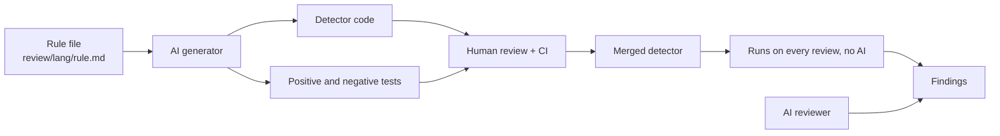

# AI-Generated Deterministic Checks

**Status:** Proposal
**Origin:** Concept from the Mrlens MR review tool, where Copilot is the only component that finds issues.

## Table of Contents

- [Problem](#problem)
- [Concept](#concept)
- [Rule Files](#rule-files)
- [Generation Workflow](#generation-workflow)
- [Runtime Integration](#runtime-integration)
- [Which Rules Suit Deterministic Checks](#which-rules-suit-deterministic-checks)
- [Quality Controls](#quality-controls)
- [Risks](#risks)
- [Rollout](#rollout)

## Problem

An AI-only reviewer finds every issue with a model call. That has costs:

- **Cost and latency**: mechanical patterns (an empty `catch`, `yaml.load` without a safe loader)
  are paid for on every review.
- **Non-determinism**: the same diff can produce different findings on different runs.
- **Missed repeats**: the model may overlook a known pattern when a large diff competes for attention.
- **No proof of coverage**: a prompt rule cannot be unit tested.

An earlier Mrlens version used hand-written Java rules, and it was dropped because the rules were
narrow, Java-only and tied to CI artifacts. The cost was writing and maintaining them by hand.
AI-generated detectors remove most of that cost.

## Concept

Use the AI **once per rule, at build time**, to write deterministic code. Use that code **on every
review, at run time**, with no model call.

The AI reviewer stays in place for judgement-heavy issues. Detectors take the mechanical ones.

## Rule Files

Each rule is one Markdown file at `review/<language>/<rule-id>.md`. It is the single source of
truth for both the generated detector and its tests.

| Folder | Applies to |
|---|---|
| `review/java` | `*.java` |
| `review/typescript` | `*.ts`, `*.tsx`, `*.js`, `*.jsx` |
| `review/python` | `*.py` |
| `review/sql` | `*.sql` |
| `review/config` | `*.yaml`, `*.yml`, `*.properties`, `*.json` |
| `review/common` | language-independent rules applied to any source file |

A rule file has these sections, in this order. `review/README.md` has the template.

1. **Metadata**: id, language, category, severity, confidence, detection type, source.
2. **Intent**: the defect in one or two sentences.
3. **Detect**: precise, testable conditions.
4. **Do not flag**: explicit exclusions that keep false positives down.
5. **Examples**: code that must be flagged and code that must not.
6. **Implementation notes**: the preferred mechanism (AST, regex, existing linter rule) and anchoring.
7. **Required tests**: the cases the generator must produce (deterministic and hybrid rules).
8. **AI prompt**, **Why AI / Why hybrid** and **Evaluation cases**: for `hybrid` and `ai` rules, the
   exact question and evidence the tool passes to the model, and snippets with expected verdicts
   used to check the prompt.

Rules should be written so that a generator needs no further interpretation.

## Generation Workflow

1. A maintainer writes or edits a rule file.
2. The generator receives the rule file and a fixed prompt: produce the detector in the target
   mechanism, plus tests covering every example and every "do not flag" item.
3. The generated code is committed through a normal pull request.
4. A human reviews the detector and the tests. Review checks the tests, not only the detector.
5. CI runs the tests and a corpus check (see [Quality Controls](#quality-controls)).
6. The rule's front matter records the generator model and date, so regeneration is traceable.

When a rule changes, regenerate the detector. Never hand-edit generated code without updating the
rule file, or the two drift apart.

## Runtime Integration

In Mrlens terms:

- Add a `RuleDetector` interface that takes a `FileAnalysisInput` (path, content, changed lines)
  and returns `Finding`s.
- Run all detectors that match the file's language before the AI step. Keep only findings on
  changed lines, using the existing `ChangedLineMap`.
- Pass the same fingerprinting, duplicate detection, dismissal and publishing path the AI findings use.
- Give the AI prompt the ids of rules already covered, so it does not repeat them and spends its
  attention elsewhere.
- Mark the finding source (`rule:<id>` or `ai`) so the UI and score can tell them apart.

Where a mature linter already implements a rule (ESLint, Checkstyle, PMD, SpotBugs, Ruff, Semgrep),
the generator should emit configuration or a thin adapter instead of new detection code.

## Which Rules Suit Deterministic Checks

Every rule file declares one of three detection types. The tool uses that to decide whether to call the model.

| Type | Decided by | AI call at review time |
|---|---|---|
| `ast`, `regex`, `linter` | Generated detector only | None |
| `hybrid` | Detector finds candidates, AI confirms | Only for files with candidates, using the rule's `AI prompt` |
| `ai` | AI only: needs intent, cross-file, runtime or deployment context | Always, for matching files, using the rule's `AI prompt` |

`review/INDEX.md` lists every rule with its type. Of the 320 rules, 59 are fully deterministic,
113 are hybrid and 148 are AI-only. Most AI-only rules cover transactions, messaging, distributed
side effects, caches, AWS, API contracts and test adequacy.

The AI calls are batched per file and per language: all `ai` and `hybrid` prompts that apply to a
file are combined into one review prompt, with the evidence each rule asks for. Deterministic
findings are passed to the model as already-reported so it does not repeat them.

| Suitable for a detector | Needs the AI |
|---|---|
| Syntactic or local patterns | Intent versus ticket (goal delivery) |
| Banned or dangerous API use | Cross-file or cross-service reasoning |
| Missing arguments or flags (`timeout=`, `from e`) | Concurrency that depends on caller context |
| Secrets and credentials | "Is this test meaningful" |
| Migration statements with known hazards | Business-invariant consistency |

## Quality Controls

- **Positive and negative tests** are mandatory for every rule.
- **Corpus run**: run each detector over a corpus of real, reviewed code. Record the hit count
  and review a sample. Reject a rule whose precision is not acceptable.
- **Mutation check**: flip a flagged example to its fixed form and confirm the finding disappears.
- **Determinism**: running the detector twice must give identical output.
- **Performance budget**: set a per-file time limit and fail the build if exceeded.
- **Severity cap**: pattern-based findings cap at the severity in the rule file. Rules with known
  false positives use `confidence: LOW` or `MEDIUM`.
- **Suppression**: support a per-line suppression marker so teams can silence a false positive
  without disabling the rule.

## Risks

- **False positives** erode trust faster than missed findings. Keep rules narrow and prefer
  precision over recall.
- **Generator errors**: generated code can look right and be wrong. The tests and the corpus run
  protect against this; the human review does not replace them.
- **Rule sprawl**: every rule needs an owner and a regular review. Remove rules that fire without
  producing fixes.
- **Language-version drift**: rules that depend on language or framework versions must state them.
- **Duplicate findings** between a detector and the AI reviewer: avoid by passing covered rule ids
  to the prompt and by using the existing fingerprint de-duplication.

## Rollout

1. Implement `RuleDetector` and one generated Java rule end to end (`java/empty-catch-block`).
2. Add a corpus-run command and the suppression marker.
3. Generate the remaining rules in `review/` one language at a time, starting with high-precision
   security and error-handling rules.
4. Feed covered rule ids into the AI prompt.
5. Measure: findings per source, fix rate, dismissal rate, review time and model cost. Retire rules
   with high dismissal rates.
